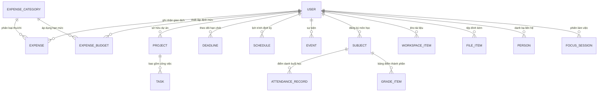

<div align="center">

# 📊 Personal Life App — Phần Mềm Quản Trị Tài Chính, Ngân Sách, Dự Án & Học Vụ
### Full-Stack Personal ERP, Expense & Budget Control, Project Management & Windows Portable Suite

-003B57?logo=sqlite&logoColor=white)


-10B981)
-0078D6?logo=windows&logoColor=white)

*Hệ thống phần mềm quản trị cá nhân & học vụ toàn diện (Personal ERP Suite — Phiên bản V16) tích hợp quản lý Thu-Chi, kiểm soát Hạn mức Ngân sách & Hoạch định Ngân sách Sinh tồn, quản lý Tiến độ Dự án – Công việc, Sổ Ghi bài – Bảng điểm – Điểm danh, Sự kiện Âm/Dương lịch, Báo cáo Thống kê đa chiều và đóng gói bộ cài đặt độc lập trên Windows có cơ chế tự động sao lưu CSDL (`v1 → v10`) khi nâng cấp phiên bản.*

[🎯 Tổng quan Nghiệp vụ](#-tổng-quan-nghiệp-vụ--bài-toán-giải-quyết) •
[💼 Điểm nhấn CSDL, BA & Triển khai](#-điểm-nhấn-năng-lực-thiết-kế-csdl-sql--phân-tích-nghiệp-vụ-ba--triển-khai) •
[🗄️ Thiết kế CSDL (20 Bảng)](#-thiết-kế-cơ-sở-dữ-liệu-quan-hệ-20-bảng--migrations-v1--v10) •
[🏗️ Kiến trúc & 24 Phân hệ API](#️-kiến-trúc-hệ-thống--24-routers-nghiệp-vụ) •
[🚀 Hướng dẫn Cài đặt & Đóng gói](#-hướng-dẫn-cài-đặt--đóng-gói-bộ-cài-windows-portable)

</div>

---

## 🎯 Tổng Quan Nghiệp Vụ & Bài Toán Giải Quyết

**Personal Life App (V16)** được thiết kế như một hệ thống **Quản trị Nguồn lực Cá nhân & Học vụ (Personal ERP)** thu nhỏ, giải quyết bài toán phân mảnh dữ liệu khi người dùng phải quản lý đồng thời **Tài chính – Ngân sách**, **Dự án – Công việc**, **Lịch biểu Âm/Dương – Thời hạn (Deadlines)** và **Học vụ – Sổ ghi bài – Điểm danh** trên nhiều công cụ rời rạc.

Thay vì chỉ dừng ở một ứng dụng ghi chú đơn giản, dự án tập trung vào **3 trụ cột kỹ thuật thực tế của phần mềm quản trị**:
1. **Quản lý Nghiệp vụ Tài chính – Ngân sách & Dự án chặt chẽ:** Phân loại giao dịch thu/chi theo danh mục, thiết lập trần ngân sách định kỳ (`ExpenseBudget`), tính toán **Kế hoạch Ngân sách Sinh tồn** (cân đối số dư hiện có, chi phí cố định và số ngày còn lại), và quản lý vòng đời dự án – công việc – lịch trình Âm/Dương lịch.
2. **Thiết kế CSDL Quan hệ Chuẩn hóa (20 Bảng) & Truy vấn Thống kê (`Analytics`):** Lưu trữ bền vững trên CSDL quan hệ thông qua **SQLAlchemy 2.0**, đảm bảo tính toàn vẹn tham chiếu và tổng hợp báo cáo trực quan trên Dashboard.
3. **Đóng gói Triển khai & Bảo trì Phần mềm Chuẩn Thực Tế (`V1 → V16`):** Xây dựng bộ cài đặt **Windows Portable (`.zip`)** chạy ngay không cần cấu hình thủ công, tách biệt hoàn toàn dữ liệu khách hàng (`%APPDATA%\PersonalLifeApp`) khỏi thư mục chương trình, kết hợp **Engine Migration tự động sao lưu CSDL (`v1 → v10`)** và cấp phát **Khóa khôi phục (`Recovery Key`)** trước mỗi lần nâng cấp phiên bản.

---

## 💼 Điểm Nhấn Năng Lực: Thiết Kế CSDL (SQL) • Phân Tích Nghiệp Vụ (BA) • Triển Khai

| Góc Nhìn Đánh Giá | Giải Pháp Kỹ Thuật & Nghiệp Vụ Đã Triển Khai Trong Dự Án |
| :--- | :--- |
| **🗄️ Thiết Kế CSDL & Lập Trình SQL**<br>*(Database Engineering)* | • **Lược đồ CSDL 20 Bảng Quan hệ (`backend/app/models/`):** Chuẩn hóa dữ liệu thành 5 nhóm phân hệ rõ ràng: *Tài chính & Ngân sách, Dự án & Công việc, Học vụ & Điểm danh, Kho tri thức & Sổ ghi bài (`class_notes`), Quản trị hệ thống & Nhật ký AI*.<br>• **Truy vấn Tổng hợp & Báo cáo (`analytics.py`, `dashboard.py`):** Truy vấn đối chiếu tổng chi tiêu theo từng danh mục (`GROUP BY category_id`) so với định mức ngân sách (`expense_budget`), thống kê tỷ lệ hoàn thành công việc đúng hạn, đếm số lượng ghi bài theo môn học và tổng hợp thời lượng tập trung.<br>• **Tự động Nâng cấp Lược đồ CSDL (`migrations.py` — Version 1 $\rightarrow$ 10):** Tự động kiểm tra bảng `app_metadata` (`key = 'database_version'`), dò cấu trúc cột hiện hành (`PRAGMA / sqlite_master`) và thực thi chuỗi nâng cấp lược đồ an toàn. |
| **📋 Phân Tích Nghiệp Vụ**<br>*(Business Analysis - BA)* | • **Quản lý Yêu cầu & Cải tiến qua 16 Phiên bản (`docs/PROJECTS_V7..V16_CHANGELOG.md`):** Tài liệu hóa chi tiết quá trình khảo sát trải nghiệm người dùng, chuẩn hóa luồng nhập liệu chứng từ thu-chi, bổ sung phân hệ **Hỗ trợ ghi bài theo môn học (`V15–V16`)** và **Lịch sự kiện quy đổi Âm/Dương lịch tự động (`V16`)**.<br>• **Quy tắc Nghiệp vụ Tài chính & Ngân sách (`expenses.py`, `expense_budgets.py`):** Quản lý danh mục thu/chi chuẩn hóa, kiểm soát hạn mức ngân sách theo danh mục, tích hợp bài toán tối ưu chi tiêu theo số ngày còn lại.<br>• **Quy tắc Nghiệp vụ Học vụ & Tiến độ (`student_hub.py`, `projects.py`):** Theo dõi chuyên cần (`AttendanceRecord`), quản lý thành phần điểm (`GradeItem`), liên kết môn học – vở ghi bài – hạn nộp (`Deadline`) – lịch học (`Schedule`). |
| **🚀 Triển Khai & Bảo Hành Phần Mềm**<br>*(Implementation & Support)* | • **Cơ chế Tự động Sao lưu Trước Nâng cấp (`prepare_database_upgrade_backup`):** Trước khi nâng cấp CSDL từ phiên bản cũ lên `v10`, hệ thống tự động tạo bản sao lưu dự phòng (`before-upgrade-vX-to-v10`) để phòng ngừa rủi ro mất dữ liệu.<br>• **Tách biệt Dữ liệu Khách hàng & Bộ cài Chương trình (`storage.py`):** Toàn bộ CSDL, khóa khôi phục (`Recovery Key`), file đính kèm (`uploads`), bản sao lưu (`backups`) và nhật ký lỗi (`logs`) được lưu tại `%APPDATA%\PersonalLifeApp`. Khi cập nhật phần mềm phiên bản mới, người dùng chỉ cần chép đè thư mục chương trình mà **không mất bất kỳ dữ liệu cũ nào**.<br>• **Đóng gói 1-Click Windows Portable (`tools/build_portable_windows.bat`):** Tự động biên dịch giao diện, đóng gói Backend + Frontend thành tệp `PersonalLifeApp_HSSV_Portable.zip`, tự động tạo Shortcut ngoài Desktop và ghi log vận hành phục vụ bảo hành/hỗ trợ kỹ thuật. |

---

## 🗄️ Thiết Kế Cơ Sở Dữ Liệu Quan Hệ (20 Bảng) & Migrations (`v1 → v10`)

Hệ thống CSDL trong `backend/app/models/` gồm **20 bảng quan hệ** được phân chia theo đúng các phân hệ nghiệp vụ:



### Danh Mục 5 Phân Hệ Dữ Liệu (20 Bảng SQLAlchemy 2.0)

| Phân Hệ Nghiệp Vụ | Các Bảng CSDL (`backend/app/models/`) | Chức Năng Nghiệp Vụ Chính |
| :--- | :--- | :--- |
| **1. Tài chính & Ngân sách**<br>*(Finance & Budgeting)* | `expense`, `expense_budget`, `expense_category` | Lưu trữ chứng từ giao dịch thu/chi, phân loại theo danh mục chuẩn, thiết lập hạn mức ngân sách định kỳ và đối chiếu số dư/vượt hạn mức. |
| **2. Dự án, Công việc & Lịch biểu**<br>*(Project & Task Management)* | `project`, `task`, `deadline`, `schedule`, `event`, `person` | Quản lý danh mục dự án, phân rã đầu việc (`task`), theo dõi trạng thái hoàn thành, quản lý thời hạn (`deadline`), lịch biểu tuần và danh bạ liên kết (`person`). |
| **3. Học vụ, Điểm danh & Đánh giá**<br>*(Academic & Attendance Hub)* | `subject`, `attendance_record`, `grade_item`, `focus_session`, `gamification_event` | Quản lý môn học, lịch sử điểm danh chuyên cần, bảng điểm thành phần/trọng số, thống kê phiên tập trung Pomodoro và điểm thưởng tiến độ. |
| **4. Kho Tri thức & Tệp đính kèm**<br>*(Knowledge & File Storage)* | `workspace_item`, `file_item` | Quản lý tài liệu ghi chú chuẩn Markdown và liên kết siêu dữ liệu (metadata) của các tệp tin đính kèm lưu trên ổ cứng. |
| **5. Quản trị Hệ thống & Trợ lý AI**<br>*(System Admin & AI Context)* | `user`, `app_setting`, `app_metadata`, `ai_chat_history` | Quản lý tài khoản người dùng, tham số cấu hình hệ thống, phiên bản lược đồ CSDL (`database_version = 10`) và lịch sử hội thoại trợ lý thông minh. |

---

## 🏗️ Kiến Trúc Hệ Thống & 24 Routers Nghiệp Vụ

```text
personal-life-app/
├── frontend/                        # Giao diện SPA (React 19 + Vite 8 + Zustand 5)
│   ├── src/                         # Các phân khu UI: Dashboard, Thu-Chi & Ngân sách, Dự án, Học vụ, Kho tài liệu
│   ├── package.json                 # Cấu hình dependencies & công cụ kiểm tra mã nguồn (oxlint)
│   └── vite.config.js               # Cấu hình đóng gói tài nguyên tĩnh cho Desktop/Web Server
├── backend/                         # Máy chủ Nghiệp vụ (FastAPI + SQLAlchemy 2.0 + Pydantic v2)
│   ├── app/
│   │   ├── models/                  # 20 bảng CSDL quan hệ (Expense, Budget, Project, Task, Subject, Grade...)
│   │   ├── routers/                 # 24 API Routers chia theo từng phân hệ nghiệp vụ độc lập
│   │   ├── schemas/                 # Ràng buộc dữ liệu đầu vào/đầu ra (Pydantic Validation Contracts)
│   │   ├── database.py              # Kết nối SQLite/SQLAlchemy & quản lý phiên giao dịch (Session)
│   │   ├── migrations.py            # Engine nâng cấp lược đồ CSDL tự động (v1 -> v9) kèm Pre-Upgrade Backup
│   │   ├── storage.py               # Quản lý thư mục dữ liệu độc lập tại %APPDATA%\PersonalLifeApp
│   │   ├── security.py              # Xác thực, băm mật khẩu & kiểm soát truy cập
│   │   └── html_sanitizer.py        # Làm sạch dữ liệu đầu vào chống tấn công XSS
│   ├── desktop_server.py            # Trình khởi chạy máy chủ cục bộ & phục vụ giao diện SPA trên Windows
│   └── requirements.txt             # Danh sách thư viện Python cố định phiên bản
├── docs/                            # Tài liệu đặc tả thay đổi nghiệp vụ từ phiên bản V7 đến V14
├── tools/                           # Bộ công cụ tự động đóng gói bản cài đặt Windows Portable (.bat)
└── BUILD_PORTABLE_ON_WINDOWS.md     # Tài liệu hướng dẫn đóng gói, triển khai & bảo toàn dữ liệu người dùng
```

### Tóm Tắt 24 Phân Hệ API (`backend/app/routers/`)
- **Phân hệ Tài chính – Ngân sách:** `expenses.py` (CRUD giao dịch thu/chi), `expense_budgets.py` (quản lý định mức ngân sách), `expense_categories.py` (danh mục thu/chi).
- **Phân hệ Dự án – Công việc – Lịch biểu:** `projects.py`, `tasks.py`, `deadlines.py`, `schedules.py`, `events.py`, `reminders.py`, `calendar_export.py` (xuất lịch chuẩn `.ics`), `people.py`.
- **Phân hệ Học vụ – Điểm danh – Tập trung:** `student_hub.py`, `subjects.py`, `focus.py`, `gamification.py`.
- **Phân hệ Báo cáo Tổng hợp & Tìm kiếm:** `dashboard.py` (tổng hợp chỉ số KPI toàn hệ thống), `analytics.py` (báo cáo phân tích xu hướng), `search.py` (tra cứu đa phân hệ).
- **Phân hệ Quản trị, Sao lưu & Trợ lý AI:** `auth.py`, `backup.py` (sao lưu & khôi phục CSDL), `settings.py`, `files.py`, `workspace.py`, `ai.py`.

---

## 🚀 Hướng Dẫn Cài Đặt & Đóng Gói Bộ Cài Windows Portable

### 1. Chạy Môi Trường Phát Triển (Development Mode)

**Khởi động Backend (FastAPI + SQLAlchemy 2.0):**
```bash
cd backend
python -m venv venv
.\venv\Scripts\activate
pip install -r requirements.txt
uvicorn app.main:app --reload --port 8000
```

**Khởi động Frontend (React 19 + Vite 8):**
```bash
cd frontend
npm install
npm run dev
```

### 2. Đóng Gói & Triển Khai Bộ Cài Đặt Windows Portable (`1-Click Deployment`)

Dự án tích hợp sẵn kịch bản đóng gói tự động phục vụ triển khai nhanh cho người dùng cuối trên Windows (chi tiết tại [`BUILD_PORTABLE_ON_WINDOWS.md`](BUILD_PORTABLE_ON_WINDOWS.md)):

1. Chạy script đóng gói tại `tools/build_portable_windows.bat`.
2. Hệ thống tự động biên dịch bản build tối ưu và xuất tệp cài đặt độc lập:
   `portable/PersonalLifeApp_HSSV_Portable.zip`
3. Người dùng cuối chỉ cần giải nén và bấm **`Start Personal Life App.bat`**:
   - Tự động khởi tạo/nâng cấp CSDL lên phiên bản mới nhất (`v9`) tại `%APPDATA%\PersonalLifeApp`.
   - Tự động tạo biểu tượng (`Shortcut`) ngoài màn hình Desktop trong lần chạy đầu tiên.
   - Ghi nhận toàn bộ nhật ký vận hành tại `%APPDATA%\PersonalLifeApp\logs` để hỗ trợ kiểm tra và bảo hành dễ dàng.

---

<div align="center">

**Tác giả:** **Phan Quốc Bảo (Kizakawa) — Sinh viên ngành Khoa học máy tính** • 📧 [vivyngocnghech@gmail.com](mailto:vivyngocnghech@gmail.com)  
[⬅️ **Quay lại Trang chủ Portfolio GitHub (@Kizakawa)**](https://github.com/Kizakawa)

</div>
